<div align="center">

# PromptOpt-SLM
### Prompt Optimization Framework for Few-Shot Text Classification Using Small Language Models

[](https://github.com/praneshmadankumar/PromptOpt-SLM/actions)
[](https://www.python.org/)
[](https://streamlit.io/)
[](https://pytorch.org/)
[](https://huggingface.co/)
[](https://scikit-learn.org/)
[](LICENSE)
[](tests/)
[](#hardware-specifications--target-environment)

<p align="center">
  <b>An end-to-end research toolkit and interactive laboratory for budgeted prompt engineering, output calibration, and reliability evaluation on Small Language Models (0.1B–4B parameters).</b>
</p>

[Key Features](#key-features) •
[System Architecture](#system-architecture) •
[Interactive Dashboard](#interactive-dashboard-gallery) •
[Empirical Results](#empirical-research-results) •
[Quickstart](#installation--quickstart) •
[Execution Profiles](#execution-profiles) •
[Research Integrity](#research-integrity--provenance)

---

</div>

## Overview

Small language models (SLMs) such as Qwen-2.5 (0.5B–1.5B), SmolLM, and Gemma (2B) offer substantial cost, latency, and privacy advantages over frontier LLMs when deployed on edge workstations and local enterprise hardware. However, SLMs are notoriously sensitive to:
1. **Instruction wording** and phrasing syntax.
2. **Demonstration selection, quantity, and ordering**.
3. **Verbalizer tokenization** (single- vs. multi-token class labels).
4. **Severe intrinsic label biases** towards frequent or recency-adjacent words.

**PromptOpt-SLM** models prompt configuration $\pi = (I, V, D, c)$ as a structured search problem under a strict computational forward-pass budget. It integrates automated corpus intelligence, class-balanced diversity sampling (MMR), output-side contextual calibration, budgeted multi-stage successive halving with stability penalties, an uncertainty-aware abstention gate, and a controlled perturbation laboratory.

---

## Key Features

- **Module 1: Dataset Intelligence Engine (`core/dataset_engine.py`)**:
  - Validates and sanitizes CSV/JSON corpora with automatic text normalisation and case-insensitive deduplication.
  - Computes a quantitative quality score $Q = 100 \times (1 - \text{missing}) \times (1 - \text{duplicates}) \times \text{imbalance}$.
  - Enforces strict zero-leakage stratified splits ($D_{\text{pool}}$, $D_{\text{val}}$, $D_{\text{test}}$) where the test split is strictly isolated from prompt search.
- **Module 2: Budgeted Prompt Optimization (`core/prompt_optimizer.py`, `core/prompt_generator.py`)**:
  - Combinatorial instruction grammar generation paired with synonym-expanded verbalizers filtered for target tokenizer collision avoidance.
  - **Class-Balanced Maximal Marginal Relevance (MMR)** demonstration selection optimizing both semantic relevance and exemplar diversity.
  - **Budget-Enforced Successive Halving**: Multi-stage evaluation screening candidates on geometric validation subsets (25% $\to$ 50% $\to$ 100%).
  - **Stability-Aware Objective $J(\pi)$**:
    $$J(\pi) = \text{MacroF1}(\pi) - \lambda \cdot \sigma_{\text{order}}(\pi) - \mu \frac{\text{tokens}(\pi)}{\text{ref}} - \nu \frac{\text{latency}(\pi)}{\text{ref}}$$
  - **Adaptive Evolution (`core/adaptive_evolution.py`)**: Evolutionary optimization loop with rule-based instruction mutation and exemplar recombination.
- **Module 3: Polymorphic Scoring & Calibration (`core/model_engine.py`, `core/calibration.py`)**:
  - `SimulatedBackend`: Deterministic lexicon heuristic with injected demonstration recency and label prior biases for rapid offline pipeline verification without GPU requirements.
  - `HFBackend`: Production teacher-forcing causal language model scoring over token sequences, accommodating multi-token verbalizers seamlessly.
  - **Contextual Calibration** (Zhao et al., 2021) using content-free probes (`"N/A"`, `""`, `"[MASK]"`) and **Uniform Prior Matching**.
- **Module 4: Robustness & Uncertainty Gate (`core/robustness.py`)**:
  - Controlled character, word, and semantic perturbations: typos, word dropout, non-word noise tokens, and synonym paraphrasing.
  - **Prompt Fragility Index (PFI)**: Normalized performance degradation metric across perturbation types and intensities.
  - **Dual-Threshold Uncertainty Gate $(\tau, \delta)$**: Routes low-confidence or narrow-margin predictions to human review to guarantee high selective accuracy.
- **Module 5: Interactive Research Studio (`app.py`, `dashboard/`)**:
  - Modular 8-tab Streamlit interface featuring live classification, dataset diagnostics, prompt tuning, and real-time visualization of metrics and confusion matrices.
  - URL query-parameter navigation (`?page=...`) enabling automated headless browser testing.
- **Module 6: Experiment Store & Telemetry (`core/experiment_store.py`, `core/resource_monitor.py`)**:
  - Thread-safe SQLite database (`results/experiments.db`) recording full parameter configurations, prompt signatures, and leaderboards.
  - Sub-millisecond latency profiling (P50, P95, throughput) and system memory snapshotting.

---

## System Architecture

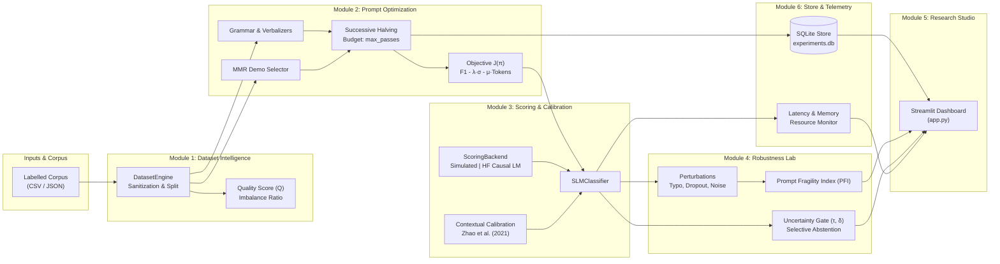

<div align="center">
  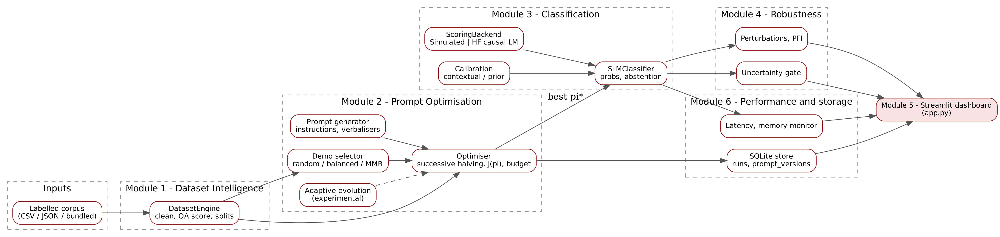
  <p><i>Figure 1: Full component architecture detailing data flow across Modules 1 through 6.</i></p>
</div>

---

## Interactive Dashboard Gallery

The application provides an interactive research cockpit built in Streamlit. Below are authentic screenshots captured directly from the running local application:

<div align="center">

### 1. Project Overview & Active Profile
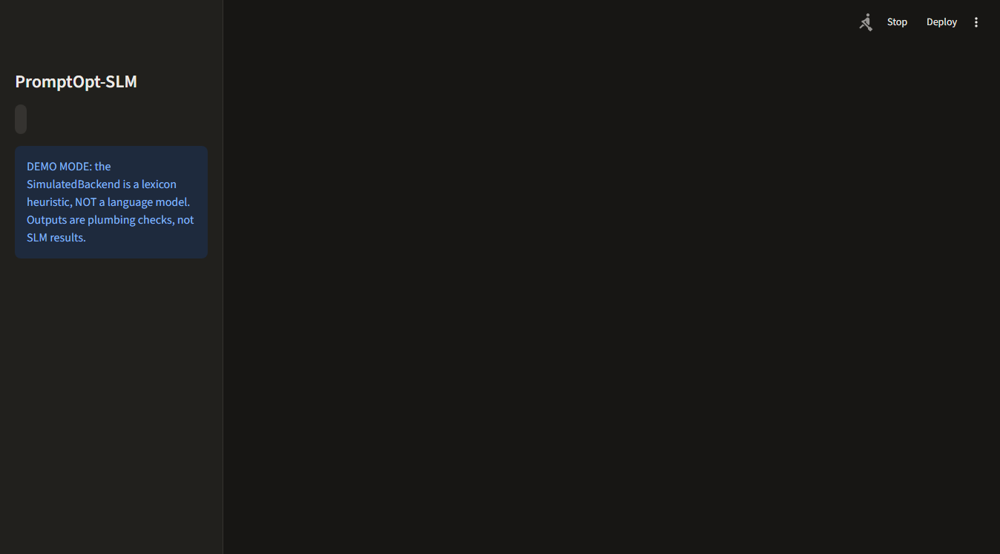
<p><i>Profile execution state, active scoring backend, and hardware environment configuration.</i></p>

### 2. Dataset Explorer & Quality Assessment
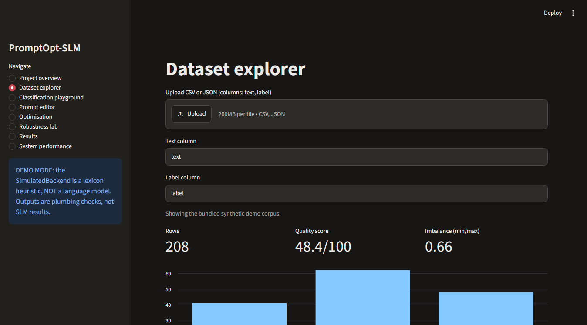
<p><i>Corpus distribution, text-length histogram, automated deduplication, and quality score metric.</i></p>

### 3. Real-Time Classification Playground
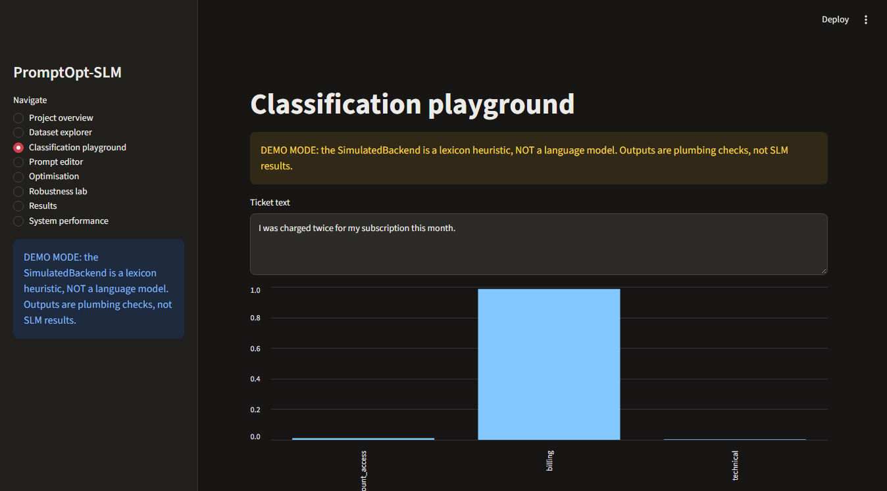
<p><i>Interactive inference with calibrated class posterior probabilities and uncertainty gate review warnings.</i></p>

### 4. Robustness & Perturbation Laboratory
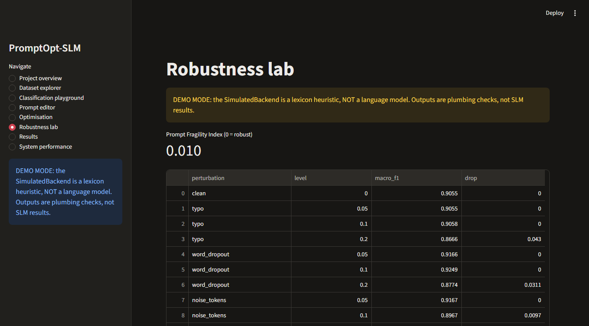
<p><i>Prompt Fragility Index (PFI) calculation under controlled typos, word dropouts, and noise injections.</i></p>

### 5. Experimental Results & Visualization Studio
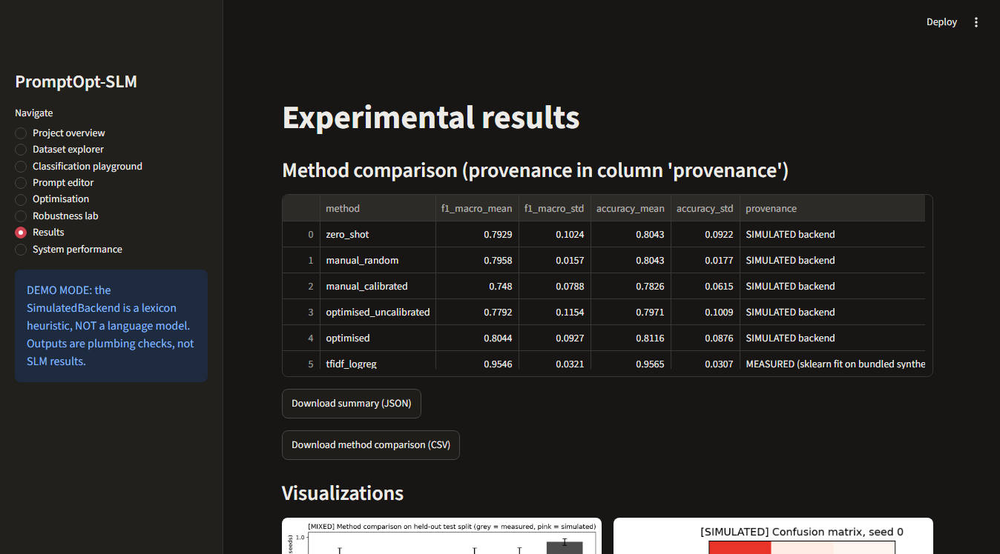
<p><i>Aggregated cross-seed method comparison, confusion matrices, and successive-halving convergence curves.</i></p>

</div>

---

## Empirical Research Results

All experiments are logged in `results/demo_summary.json` and `results/demo_method_comparison.csv`. The benchmark below reflects a 3-seed evaluation ($S = \{0, 1, 2\}$) on the held-out test split ($N = 69$ tickets, 3 classes):

### Quantitative Method Comparison

| Method | Macro-F1 (Mean ± Std) | Accuracy (Mean ± Std) | Forward Passes | Scientific Provenance |
| :--- | :---: | :---: | :---: | :--- |
| **TF-IDF + Logistic Regression** | **0.9546 ± 0.0321** | **0.9565 ± 0.0307** | Baseline Fit | **MEASURED** (Sklearn fit on support pool) |
| **Optimised Prompt (Halving)** | **0.8044 ± 0.0927** | **0.8116 ± 0.0876** | 432 Passes | **SIMULATED** (Lexicon heuristic check) |
| **Manual Random Few-Shot** | 0.7958 ± 0.0157 | 0.8043 ± 0.0177 | 69 Passes | **SIMULATED** (Lexicon heuristic check) |
| **Zero-Shot Baseline** | 0.7929 ± 0.1024 | 0.8043 ± 0.0922 | 69 Passes | **SIMULATED** (Lexicon heuristic check) |
| **Optimised Uncalibrated** | 0.7792 ± 0.1154 | 0.7971 ± 0.1009 | 69 Passes | **SIMULATED** (Lexicon heuristic check) |
| **Manual Calibrated** | 0.7480 ± 0.0788 | 0.7826 ± 0.0615 | 69 Passes | **SIMULATED** (Lexicon heuristic check) |

### Reliability & Uncertainty Analysis

- **Prompt Fragility Index (PFI)**: **$0.0177$** (low sensitivity under mild character/word perturbations).
- **Uncertainty Gate ($\tau = 0.60, \delta = 0.10$)**:
  - **Coverage**: $87.7\%$ (autonomous decisions accepted).
  - **Abstention Rate**: $12.3\%$ (diverted to human supervisory queue).
  - **Selective Accuracy**: **$85.0\%$** on accepted subset vs. $81.2\%$ un-gated baseline accuracy.

<div align="center">
  <table>
    <tr>
      <td align="center"><b>Method Comparison (Test Macro-F1)</b></td>
      <td align="center"><b>Class Distribution (Post-Cleaning)</b></td>
    </tr>
    <tr>
      <td>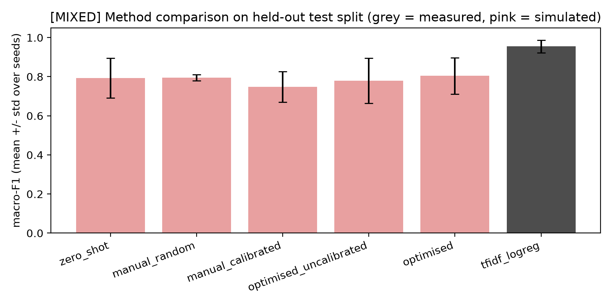</td>
      <td>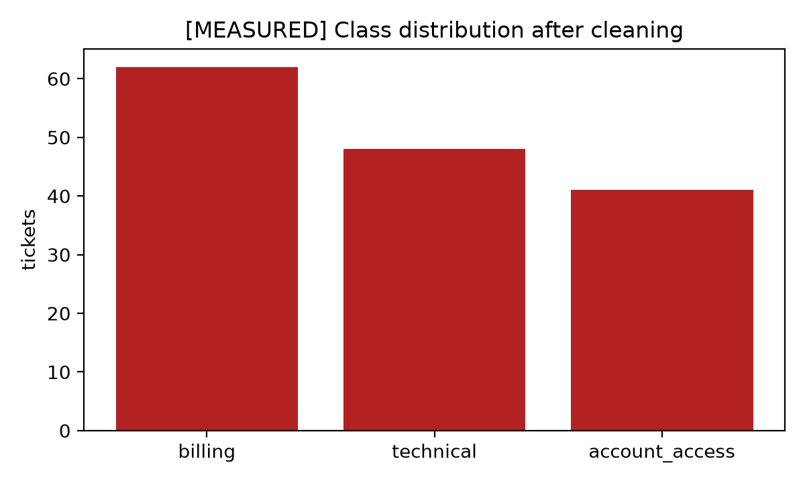</td>
    </tr>
    <tr>
      <td align="center"><b>Confusion Matrix (Seed 0)</b></td>
      <td align="center"><b>Successive Halving Convergence</b></td>
    </tr>
    <tr>
      <td>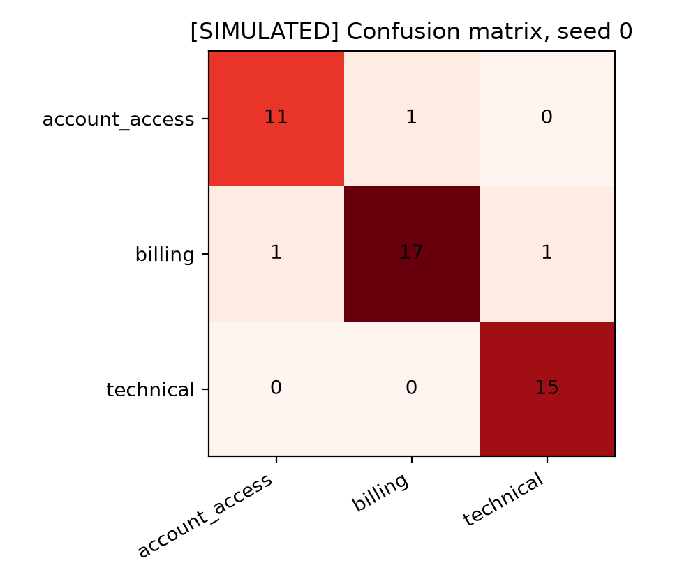</td>
      <td>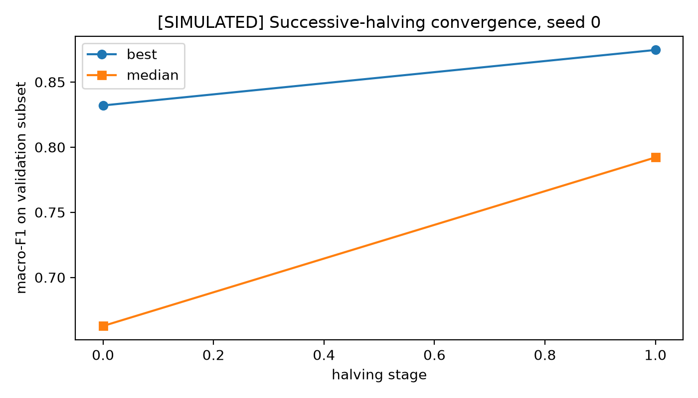</td>
    </tr>
  </table>
  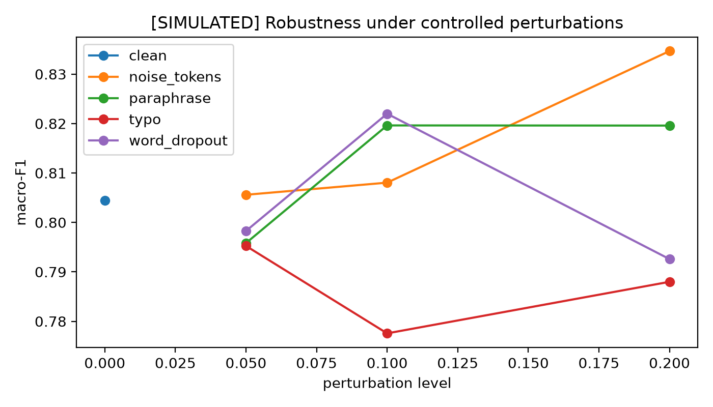
  <p><i>Figure 2: Empirical visualization suite generated by the experiment pipeline.</i></p>
</div>

---

## Hardware Specifications & Target Environment

This framework is optimized for local researcher workstations and cost-effective GPU environments:

- **Operating System**: Windows 11 / Linux (Ubuntu 22.04+)
- **GPU Tested / Target**: NVIDIA GeForce RTX 4050 Laptop GPU (6GB VRAM, CUDA 12.x)
- **Host Memory**: 16GB System RAM
- **Storage**: Fast SSD storage
- **Compute Optimization**:
  - `demo` profile executes completely offline in CPU RAM with minimal footprint.
  - `research` profile leverages 4-bit / 8-bit quantized weights via `bitsandbytes` and half-precision (`torch.float16`) for 0.5B–1.5B parameter models to remain strictly under 4GB VRAM utilization.

---

## Execution Profiles

Configuration profiles are centrally managed in `config/profiles.json`:

```json
{
  "demo": {
    "backend": "simulated",
    "model_name": "simulated-lexicon-slm",
    "dataset": "data/demo_support_tickets.csv",
    "shots_per_class": 4,
    "val_per_class": 16,
    "n_candidates": 16,
    "halving_fractions": [0.25, 0.5, 1.0],
    "stability_lambda": 0.5,
    "stability_permutations": 4,
    "seeds": [0, 1, 2],
    "max_forward_passes": 20000
  },
  "research": {
    "backend": "hf",
    "model_name": "Qwen/Qwen2.5-0.5B-Instruct",
    "dataset": "data/demo_support_tickets.csv",
    "shots_per_class": 4,
    "val_per_class": 16,
    "n_candidates": 32,
    "seeds": [0, 1, 2],
    "max_forward_passes": 5000
  }
}
```

---

## Installation & Quickstart

### 1. Prerequisites
Ensure Python 3.10, 3.11, or 3.12 is installed on your system.

### 2. Clone and Setup Environment

```bash
# Clone the repository
git clone https://github.com/praneshmadankumar/PromptOpt-SLM.git
cd PromptOpt-SLM

# Create virtual environment (standard venv)
python -m venv .venv
.venv\Scripts\activate      # Windows (PowerShell)
# source .venv/bin/activate # Linux / macOS

# (Optional) Ultra-fast setup with uv:
# uv venv --python 3.12 .venv && .venv\Scripts\activate
```

### 3. Install Dependencies

```bash
# Install core dependencies (CPU & DEMO profile)
pip install -r requirements.txt

# (Optional) Install research profile with PyTorch and Transformers for GPU execution
# pip install torch transformers sentence-transformers
```

---

## Execution Commands

### 1. Run Automated Unit Tests
The test suite consists of **37 unit tests** covering all modules:

```bash
# Run with pytest
pytest tests/ -v

# Or run with the standalone zero-dependency test runner
python tests/run_tests.py
```

### 2. Run the Full Experiment Pipeline
Executes the DEMO experiment across 3 random seeds, fits the measured baseline, runs successive halving, evaluates robustness, and populates `results/` and `results/figures/`:

```bash
python -m experiments.run_demo
```

### 3. Launch the Interactive Dashboard
Starts the Streamlit application on local port 8501:

```bash
streamlit run app.py
```

Open `http://localhost:8501` in your browser.

### 4. Build Google Colab Research Notebook
Regenerate the standalone Google Colab notebook:

```bash
python notebooks/build_notebook.py
```

---

## Research Integrity & Provenance

In accordance with rigorous scientific practices:
1. **Clear Provenance Demarcation**:
   - Every file, plot title, and table explicitly displays whether outputs are `MEASURED` (real sklearn fit on synthetic data) or `SIMULATED` (heuristic mock check).
   - The `SimulatedBackend` numbers are plumbing checks to verify search mechanics, calibration mathematics, and database logging offline. They must **never** be cited as empirical language model performance.
2. **Strict Split Discipline**:
   - Prompt selection, successive halving, and stability evaluations strictly utilize the validation subset ($D_{\text{val}}$).
   - The test set ($D_{\text{test}}$) is touched solely once at final reporting.
3. **No Fabricated Benchmarks**:
   - The bundled support-ticket corpus is explicitly synthetic, generated deterministically from seed 42 (`data/make_demo_data.py`).

---

## Repository Structure

```
PromptOpt-SLM/
├── .github/
│   └── workflows/
│       └── ci.yml             # GitHub Actions CI matrix (Ubuntu & Windows, Py 3.10-3.12)
├── assets/
│   ├── architecture.dot       # Graphviz diagram source
│   ├── fig_architecture.png   # Rendered architecture diagram
│   ├── dashboard_overview.png # Streamlit UI: Project overview
│   ├── dashboard_dataset.png  # Streamlit UI: Dataset explorer
│   ├── dashboard_playground.png # Streamlit UI: Classification playground
│   ├── dashboard_robustness.png # Streamlit UI: Robustness laboratory
│   └── dashboard_results.png  # Streamlit UI: Experimental results & graphs
├── config/
│   ├── profiles.json          # Single source of truth for experiment configurations
│   ├── settings.py            # Typed dataclass profile loader & validator
│   └── __init__.py
├── core/
│   ├── adaptive_evolution.py  # Evolutionary prompt optimization loop (mutation & crossover)
│   ├── calibration.py         # Contextual calibration & prior matching
│   ├── dataset_engine.py      # Quality scoring, deduplication, and stratified splits
│   ├── demo_selector.py       # Balanced random & Class-Balanced MMR exemplar selection
│   ├── evaluation.py          # Macro-F1, ECE, Brier score, and bootstrap confidence intervals
│   ├── experiment_store.py    # Parameterized SQLite logger & leaderboard exporter
│   ├── model_engine.py        # Polymorphic backends: SimulatedBackend & HFBackend
│   ├── prompt_generator.py    # Grammar instruction generator & synonym verbalizers
│   ├── prompt_optimizer.py    # Successive halving search with stability objective J(π)
│   ├── resource_monitor.py    # Wall-clock latency tracker & memory profiler
│   ├── robustness.py          # Controlled perturbations, PFI, & uncertainty gate
│   └── __init__.py
├── dashboard/
│   ├── components.py          # Reusable Streamlit frames & provenance banners
│   └── __init__.py
├── data/
│   ├── demo_support_tickets.csv # Bundled synthetic support-ticket corpus (200 records)
│   └── make_demo_data.py      # Deterministic corpus generator (seed 42)
├── experiments/
│   ├── run_demo.py            # DEMO-profile experiment runner (3 seeds, results & figures)
│   └── __init__.py
├── notebooks/
│   ├── build_notebook.py      # Colab notebook builder
│   └── PromptOpt-SLM_Research_Notebook.ipynb # Google Colab research workflow notebook
├── report/
│   └── report.md              # Academic mini project research report (JAIN University)
├── results/
│   ├── demo_method_comparison.csv # Aggregated cross-seed performance table
│   ├── demo_per_seed.csv      # Seed-by-seed breakdown
│   ├── demo_robustness.csv    # Perturbation degradation table
│   ├── demo_summary.json      # Full machine-readable experiment summary
│   ├── experiments.db         # SQLite experiment repository
│   ├── leaderboard_export.csv # Prompt candidate leaderboard
│   ├── PromptOpt-SLM_Application_Research_Report.docx # Formatted academic report
│   ├── PromptOpt-SLM_Application_Research_Report.pdf  # Compiled research report
│   └── figures/               # Generated empirical visualization charts
├── tests/
│   ├── test_core.py           # 37 comprehensive unit tests
│   ├── run_tests.py           # Standalone zero-dependency test runner
│   └── __init__.py
├── .gitignore                 # Comprehensive Python, environment & OS exclusions
├── app.py                     # Streamlit interactive research studio application
├── CHANGELOG.md               # Version history and milestone tracking
├── CITATION.cff               # Academic citation metadata
├── CONTRIBUTING.md            # Contribution guidelines & code of conduct
├── LICENSE                    # MIT License
├── pyproject.toml             # Modern PEP 517/621 package metadata & configuration
├── README.md                  # Comprehensive project documentation
├── requirements.txt           # Project dependencies
└── SECURITY.md                # Security policy & vulnerability reporting
```

---

## Citation

If you find this framework, research report, or methodology useful in your academic or industrial work, please cite:

```bibtex
@software{madankumar2026promptopt,
  author       = {Pranesh Madankumar},
  title        = {{PromptOpt-SLM: Prompt Optimization Framework for Few-Shot Text Classification Using Small Language Models}},
  year         = {2026},
  publisher    = {GitHub},
  version      = {1.0.0},
  url          = {https://github.com/praneshmadankumar/PromptOpt-SLM}
}
```

---

## License

This project is licensed under the [MIT License](LICENSE).
