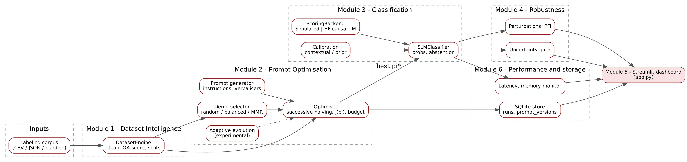
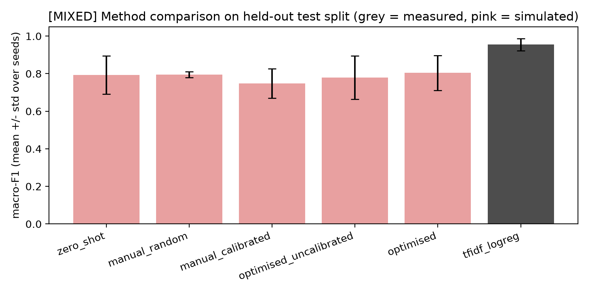
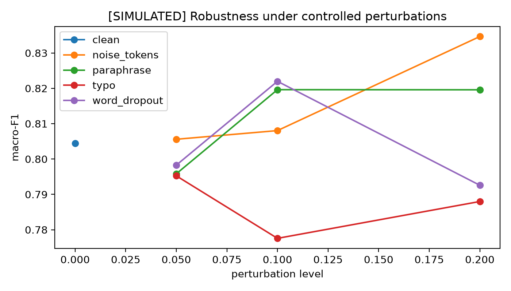
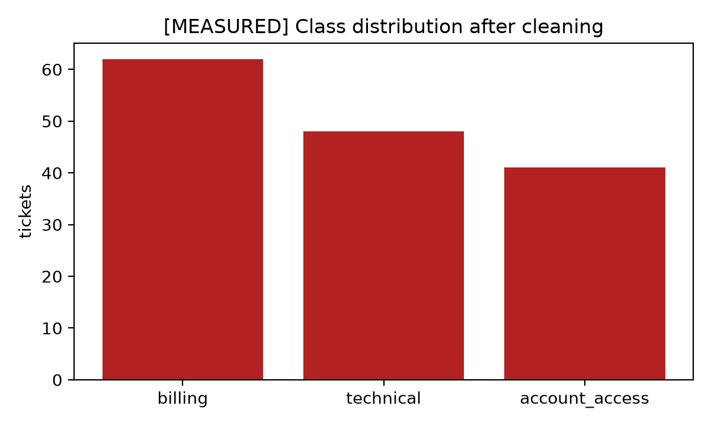
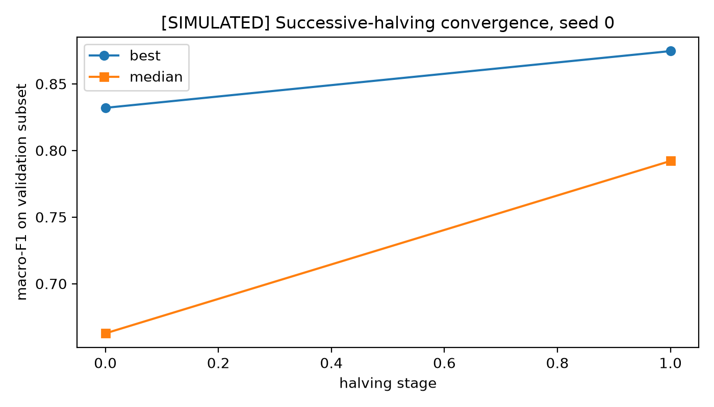

```{=openxml}
<w:p><w:pPr><w:jc w:val="center"/><w:spacing w:before="1200"/></w:pPr><w:r><w:rPr><w:b/><w:sz w:val="28"/></w:rPr><w:t>JAIN (Deemed-to-be University)</w:t></w:r></w:p>
```

::: {custom-style="Center"}
School of Computer Science and Engineering (Cloud Technology and Mobile Applications)\
Faculty of Engineering & Technology\
Jain Global Campus, Kanakapura Taluk - 562112, Ramanagara District, Karnataka, India
:::

::: {custom-style="Center"}
**A Mini Project Report for the course 25PCCS202 - Python Programming**\
Submitted in partial fulfilment for the completion of the course\
**BACHELOR OF TECHNOLOGY IN COMPUTER SCIENCE & ENGINEERING (CTMA)**\
2026-2027 (III Semester)
:::

::: {custom-style="Center"}
Submitted by\
**PRANESH MADANKUMAR (25BTRCM040)**

Under the guidance of\
**Dr. B. Narmada**, Assistant Professor\
Department of Computer Science & Engineering - CTMA
:::

```{=openxml}
<w:p><w:r><w:br w:type="page"/></w:r></w:p>
```

# Certificate

This is to certify that the mini project work for the course 25PCCS202 - Python Programming, titled **PromptOpt-SLM: Prompt Optimization Framework for Few-Shot Text Classification Using Small Language Models**, is carried out by **PRANESH MADANKUMAR (25BTRCM040)**, a bonafide student of Bachelor of Technology at the School of Computer Science and Engineering, Faculty of Engineering & Technology, JAIN (Deemed-to-be University), Bangalore, in partial fulfilment for the award of the degree in Bachelor of Technology in Computer Science & Engineering (CTMA) during the year 2026-2027.

| | |
|---|---|
| Project Guide: ______________________ | Program Head: ______________________ |
| Date: ____________ | Date: ____________ |

*These signature lines are intentionally left blank. No university approval is implied by this document.*

```{=openxml}
<w:p><w:r><w:br w:type="page"/></w:r></w:p>
```

# Declaration

I, **PRANESH MADANKUMAR (25BTRCM040)**, student of the third semester B.Tech in Computer Science & Engineering (CTMA), School of Computer Science and Engineering, Faculty of Engineering & Technology, JAIN (Deemed-to-be University), hereby declare that the mini project work titled *PromptOpt-SLM: Prompt Optimization Framework for Few-Shot Text Classification Using Small Language Models* has been carried out by me and submitted in partial fulfilment for the completion of the course 25PCCS202 - Python Programming during the academic year 2026-2027.

Place: Bangalore  
Date: ____________

Signature: ______________________ (25BTRCM040)

```{=openxml}
<w:p><w:r><w:br w:type="page"/></w:r></w:p>
```

# Nomenclature

| Symbol / Term | Description |
|---|---|
| SLM | Small language model (roughly 0.1 to 4 billion parameters) |
| ICL | In-context learning: conditioning a model on labelled examples in its prompt |
| π = (I, V, D, c) | Prompt configuration: instruction, verbalizer, demonstrations, calibration |
| V | Verbalizer, a mapping from class identifiers to label words |
| MMR | Maximal marginal relevance, a relevance-diversity selection rule |
| ECE | Expected calibration error |
| PFI | Prompt Fragility Index (proposed in this work) |
| J(π) | Interpretable optimisation objective |
| λ, μ, ν | Weights for stability, token cost and latency in $J$ |
| F1 | Harmonic mean of precision and recall |
| SQLite | Embedded relational database engine |
| CSV, JSON | Comma-separated values; JavaScript Object Notation |
| GPU, CPU | Graphics / central processing unit |
| VRAM | Video memory of a graphics card |
| TF-IDF | Term frequency-inverse document frequency text representation |

```{=openxml}
<w:p><w:r><w:br w:type="page"/></w:r></w:p>
```

# Abstract

Small language models (SLMs) can classify text from a few labelled examples, but they are sensitive to prompt wording, the choice and order of demonstrations, and the label words used for each class. PromptOpt-SLM is a Python application that treats prompt construction as a budgeted search problem. It combines a dataset quality engine, a candidate prompt generator, a class-balanced maximal-marginal-relevance demonstration selector, contextual calibration, successive-halving search with a stability-aware objective, an uncertainty gate that routes low-confidence predictions to review, a robustness laboratory, a SQLite experiment store and a Streamlit dashboard. The original research report on this topic contained illustrative numbers. This revision replaces them with values produced by executable code and labels every value as either *measured* (a real model fit on real data) or *simulated* (a deterministic lexicon heuristic used to test the pipeline). The bundled corpus is synthetic. On it, a TF-IDF with logistic regression baseline reaches a macro-F1 of 0.955 $\pm$ 0.032 over three seeds. The simulated optimised prompt reaches 0.804 $\pm$ 0.093, and its gain over a manual prompt lies inside the seed-to-seed variation. The report therefore does not claim that prompt optimisation improves small-model accuracy. It documents a working, tested framework, the evidence it produces, and the experiments that still require a real language model on a GPU.

**Keywords:** prompt optimisation, few-shot learning, in-context learning, text classification, small language models, calibration, demonstration selection, Python.

```{=openxml}
<w:p><w:r><w:br w:type="page"/></w:r></w:p>
```

# Table of Contents

Certificate; Declaration; Nomenclature; Abstract

1. Introduction (1.1 Background, 1.2 Problem statement, 1.3 Objectives, 1.4 Research questions, 1.5 Scope and contributions, 1.6 Organisation)
2. Literature Survey (2.1 to 2.6)
3. System Design (3.1 Requirements, 3.2 Architecture, 3.3 Mathematical formulation, 3.4 Data flow and use cases, 3.5 Database schema, 3.6 Design decisions)
4. Implementation (4.1 Dataset engine, 4.2 Prompt optimisation, 4.3 Classification engine, 4.4 Robustness lab, 4.5 Dashboard, 4.6 Performance and storage)
5. Results and Discussion (5.1 Setup, 5.2 Measured versus simulated evidence, 5.3 Search efficiency, 5.4 Calibration, 5.5 Uncertainty, 5.6 Robustness, 5.7 Error analysis, 5.8 Cost, 5.9 Tests, 5.10 Threats to validity)
6. Conclusions and Future Scope (6.1 to 6.6)

References

Appendices A (installation), B (example configuration), C (glossary), D (figure provenance), E (viva questions)

```{=openxml}
<w:p><w:r><w:br w:type="page"/></w:r></w:p>
```

# 1. Introduction

## 1.1 Background and motivation

Text classification underlies spam filters, sentiment dashboards, support-ticket routers and content moderation. Classical systems were trained on thousands of labelled examples. Large pre-trained models changed the workflow: Brown et al. showed that a sufficiently large autoregressive model can perform a new task from an instruction and a few examples, without gradient updates [1]. Small models make this approach affordable on a laptop or a single consumer GPU, but they are notably more fragile. Reordering the same demonstrations can move accuracy by many points [2], and a small model's prior preference for particular label words can dominate its predictions [3].

## 1.2 Problem statement

Given a classification task with a small labelled set (for example four to sixteen examples per class) and a small language model, how can a system choose an instruction, label words, demonstrations and a calibration setting that maximise accuracy and stability, using modest compute and without leaking test data into the choice?

## 1.3 Objectives

1. Review in-context learning, prompt-based learning and automatic prompt optimisation with an emphasis on small models.
2. Formalise few-shot prompt selection as a budgeted search problem with a validation-only objective.
3. Implement the framework as a modular, tested Python application with three execution profiles.
4. Evaluate it honestly: separate measured results from simulated ones and state what remains unexecuted.

## 1.4 Research questions

* **RQ1.** Does optimised prompt selection beat a manually written few-shot prompt on held-out data?
* **RQ2.** How much does calibration contribute, and does it reduce order sensitivity?
* **RQ3.** Does successive halving find configurations of similar quality at lower cost than full evaluation?
* **RQ4.** How fragile is the chosen prompt under typographical, noise and paraphrase perturbations?

## 1.5 Scope and contributions

The application contains six modules: a dataset intelligence engine, an adaptive prompt optimiser, a multi-model classification engine, a robustness and reliability lab, an interactive dashboard, and a performance and storage layer. The contributions are (i) an integrated, open-source-friendly pipeline; (ii) a validation-only objective with explicit stability, token and latency terms; (iii) a class-balanced MMR demonstration selector; (iv) an uncertainty gate with selective-accuracy reporting; and (v) a reproducible experiment runner that records the provenance of every number. Adaptive Prompt Evolution is included as an experimental extension and is not claimed as an established technique.

## 1.6 Organisation of the report

Chapter 2 reviews related work. Chapter 3 gives the system design. Chapter 4 explains the implementation. Chapter 5 reports results, limitations and threats to validity. Chapter 6 concludes and lists future work.

# 2. Literature Survey

## 2.1 From feature engineering to pre-trained models

Early classifiers used bag-of-words or TF-IDF features with linear models. Transformer encoders pre-trained on raw text and fine-tuned per task [4] achieved large gains with thousands of labelled examples, but fine-tuning is unstable when only a handful of examples exist.

## 2.2 Prompt-based learning

Liu et al. surveyed the paradigm in which the task is rewritten to resemble the pre-training objective [5]. Pattern-Exploiting Training pairs a cloze pattern with a verbalizer and showed that small models can be effective few-shot learners [6]. LM-BFF automatically generated templates and label words and found that adding demonstrations helps [7].

## 2.3 In-context learning and its sensitivity

Lu et al. showed that permutations of the same demonstrations produce a wide range of accuracies and proposed entropy-based probing to choose good orders [2]. Zhao et al. identified majority-label, recency and common-token biases and proposed contextual calibration, which estimates the bias from content-free inputs and divides it out [3]. Holtzman et al. described surface-form competition and proposed normalised scoring [8]. Min et al. found that random label replacement in demonstrations often hurts only slightly, suggesting that demonstrations mainly convey format and label space [9].

## 2.4 Demonstration selection

KATE retrieves nearest neighbours in an embedding space [10], and a learned retriever can be trained from language-model signals [11]. Sentence-BERT provides efficient sentence embeddings [12]. Pure nearest-neighbour retrieval is prone to redundancy and class imbalance, which motivates diversity-aware selection such as maximal marginal relevance and class-balanced sampling.

## 2.5 Automatic prompt optimisation

Discrete search with a large proposer LLM includes APE [13], ProTeGi [14] and OPRO [15]. DSPy treats pipelines as compilable modules [16]. Soft-prompt methods learn continuous vectors but require gradients and are not human-readable [17]. LoRA modifies weights rather than prompts [18]. Most discrete-search methods rely on a strong proposer, which conflicts with the aim of avoiding large models. PromptOpt-SLM therefore uses rule-based candidate generation and cheap validation scoring.

## 2.6 Comparative analysis and research gap

Table 2.1 summarises the approaches. Existing studies mostly address one factor at a time and mostly use large models. Few combine instruction, verbalizer, demonstration and calibration choices into a single low-cost pipeline with explicit reporting of cost and variance.

| Approach | What it optimises | Gradients | Large LLM | Human-readable |
|---|---|---|---|---|
| Manual prompt engineering | Instruction, examples | No | No | Yes |
| PET [6] | Pattern, verbalizer | Yes (fine-tune) | No | Yes |
| LM-BFF [7] | Templates, label words, demos | Yes | Uses T5 | Yes |
| Contextual calibration [3] | Output probabilities | No | No | Not applicable |
| KATE [10] | Demonstration choice | No | No | Yes |
| APE / OPRO / ProTeGi [13-15] | Instruction text | No | Yes (proposer) | Yes |
| Prompt tuning [17] | Soft prompt vectors | Yes | No | No |
| **PromptOpt-SLM (this work)** | Instruction, verbalizer, demos, calibration | No | No | Yes |

*Table 2.1. Comparison of related approaches.*

# 3. System Design

## 3.1 Requirements

**Functional.** Load CSV and JSON corpora and bundled benchmarks; clean data and report quality; split data stratified into support, validation and test sets; generate and rank prompt candidates; classify single texts and batches with confidence; flag low-confidence predictions; compare models; run robustness tests; store and export experiment results.

**Non-functional.** Reproducibility through fixed seeds and a single configuration file; bounded compute through an explicit forward-pass budget; runnable offline in DEMO mode; clear labelling of simulated results; graceful failure when a model or package is missing.

**Hardware and software.** Target: Windows 11 laptop with 16 GB RAM, an NVIDIA RTX 4050 with 6 GB VRAM and a 512 GB SSD, with CPU fallback. Software: Python 3.10 or later, numpy, pandas, scikit-learn, matplotlib, Streamlit; torch, transformers and sentence-transformers for the research profile.

## 3.2 Architecture

Figure 3.1 shows the modules and their data flow. The dataset engine produces splits; the prompt generator, demonstration selector and optional evolver supply candidates; the optimiser scores them with a scoring backend and calibration; the selected configuration drives the classifier, which feeds the uncertainty gate, robustness lab, store and dashboard.

{width=95%}

## 3.3 Mathematical formulation

A configuration is $\pi = (I, V, D, c)$. For input $x$, the prompt is $T_\pi(x)$ and the model scores each class by a sum of token log-probabilities of its label word:

$$s_\pi(y \mid x) = \sum_{t=1}^{|V(y)|} \log P_M\big(v_t^{(y)} \mid T_\pi(x), v_{<t}^{(y)}\big)$$

Scores are normalised by softmax, optionally calibrated, and the arg-max is returned. Contextual calibration uses the average distribution over content-free inputs $C = \{\text{N/A}, \text{empty}, \text{[MASK]}\}$:

$$\bar p(y) = \frac{1}{|C|}\sum_{x_{cf} \in C} P_\pi(y \mid x_{cf}), \qquad \tilde p(y \mid x) \propto \frac{P_\pi(y \mid x)}{\bar p(y)}$$

The optimisation objective uses the validation split only:

$$J(\pi) = \mathrm{MacroF1}_{val}(\pi) - \lambda\,\mathrm{Std}_\sigma\big[\mathrm{MacroF1}_{val}(\pi_\sigma)\big] - \mu\,\frac{\tau(\pi)}{\tau_{ref}} - \nu\,\frac{\ell(\pi)}{\ell_{ref}}$$

where $\pi_\sigma$ permutes the demonstrations, $\tau(\pi)$ is the mean prompt length in tokens and $\ell(\pi)$ the mean latency in milliseconds. The default values are $\lambda = 0.5$, $\mu = 0.02$, $\tau_{ref} = 200$, and $\nu = 0$, so latency is reported but not penalised by default because it is hardware-dependent.

For demonstration selection, maximal marginal relevance with a per-class cap of $\lceil m/K \rceil$ picks the next demonstration $d$ by

$$\mathrm{MMR}(d) = \alpha\cos(e(d), e(x)) - (1-\alpha)\max_{d' \in S}\cos(e(d), e(d'))$$

with $\alpha = 0.7$.

Successive halving over $N$ candidates with fractions $(0.25, 0.5, 1.0)$ evaluates roughly $N \cdot 0.25 n_v + (N/2) \cdot 0.5 n_v + (N/4) \cdot n_v$ forward passes before the final stage, plus permutation checks on the shortlist.

For robustness, the Prompt Fragility Index is

$$\mathrm{PFI} = \frac{1}{|\mathcal{P}|}\sum_{p \in \mathcal{P}} \frac{1}{|L|}\sum_{l \in L} \frac{\max\{0,\; F_1^{clean} - F_1^{p,l}\}}{F_1^{clean}}$$

and lies in $[0, 1]$, where 0 means the macro-F1 is unchanged under every tested perturbation.

The uncertainty gate accepts a prediction when $p_{max} \ge \tau$ and $p_{(1)} - p_{(2)} \ge \delta$, where $p_{(1)}$ and $p_{(2)}$ are the two largest calibrated probabilities. The expected calibration error is $\mathrm{ECE} = \sum_b \frac{|B_b|}{n}\,|\mathrm{acc}(B_b) - \mathrm{conf}(B_b)|$ over ten equal-width bins.

## 3.4 Data flow and use cases

The main use cases are: (1) *optimise a prompt* for a corpus, which returns the best configuration, a leaderboard and a version history; (2) *classify tickets* with a chosen configuration and see confidence and review flags; (3) *stress-test* a configuration; (4) *compare models or profiles*; and (5) *export* results. A user supplies a corpus or uses the bundled one, chooses a profile, and receives stored results.

## 3.5 Database schema

Experiment results are stored in SQLite (Figure 3.2). A run records its profile, dataset, backend and configuration. Each prompt version belongs to exactly one run and records its signature, template, calibration, validation macro-F1, stability and objective value.

| Table | Key columns | Relationship |
|---|---|---|
| runs | id (PK), created_at, profile, dataset, backend, model_name, config_json, metrics_json | one-to-many with prompt_versions |
| prompt_versions | id (PK), run_id (FK to runs.id), signature, template_id, calibration, n_demos, f1, std, J, config_json | many-to-one with runs |

*Table 3.1. Database schema. Foreign keys are enforced with cascade on delete.*

## 3.6 Design decisions

* **Scoring backends share one abstract interface** (`ScoringBackend`). The simulator and the Hugging Face scorer are interchangeable, so the optimiser does not depend on which one is active.
* **Full label sequences are scored.** Multi-token verbalizers are supported by summing token log-probabilities, not by assuming one token per class.
* **Truncation keeps the tail** of long prompts so the query and answer slot are never cut off.
* **Configuration lives in JSON**, not code, so profiles are versioned and reproducible.
* **Stdlib-safe module names** avoid clashing with Python standard-library modules.

# 4. Implementation

This chapter describes the six modules. Full listings are in the project archive. Each module has automated tests in `tests/test_core.py`.

## 4.1 Module 1: Dataset Intelligence Engine

**Purpose.** Load, validate, clean and split a labelled corpus.

**Features.** CSV and JSON loading (including file-like uploads), missing-value detection, case-insensitive duplicate removal, class-imbalance analysis, text-length statistics, a 0-100 quality score, stratified splits and a semantic-similarity summary.

**Algorithm.** The quality score is $Q = 100 \cdot (1 - m)(1 - d)\,b$, where $m$ is the missing rate, $d$ the duplicate rate and $b = \min_k n_k / \max_k n_k$ the class balance.

```python
class DatasetEngine:
    def split(self, val_per_class: int, test_fraction: float = 0.3, seed: int = 0):
        """Stratified support/validation/test split; test is never used for search."""
        df = self.data
        pool_df, test_df = train_test_split(df, test_size=test_fraction,
                                            stratify=df["label"], random_state=seed)
        val_df = pd.concat([g.sample(n=val_per_class, random_state=seed)
                            for _, g in pool_df.groupby("label")])
        return {"pool": pool_df.drop(val_df.index).reset_index(drop=True),
                "val": val_df.reset_index(drop=True), "test": test_df.reset_index(drop=True)}
```

**Output on the bundled corpus (measured).** 208 raw rows, 6 missing texts, 4 missing labels, 52 duplicates, class counts billing 62, technical 48, account access 41, imbalance ratio 0.661, mean length 12.0 words, quality score 48.4.

The duplicate count is high because the synthetic corpus is assembled from phrase banks, so many sentences collide. The low quality score is therefore an artefact of the synthetic generator and should not be read as a property of real support data.

**Testing.** Quality counts, cleaning, stratification, disjointness of validation and test, balanced few-shot sampling and JSON loading are all tested.

## 4.2 Module 2: Adaptive Prompt Optimisation Engine

**Purpose.** Generate candidate prompts, score them under a budget, and select the best by $J$.

**Candidate generation.** `generate_instructions` combines three verbs, three phrasings and an optional label list, giving nine variants for three classes. `generate_verbalizers` expands class names with synonyms, keeps the default mapping first, and rejects combinations whose first tokens collide.

**Search.** `PromptOptimizer.successive_halving` evaluates the pool on 25 percent of the validation set, keeps the better half, repeats at 50 percent, and finishes the shortlist on the full set with permutation stability. `Budget.charge` raises `BudgetExceededError` before a run can exceed its forward-pass limit.

```python
def successive_halving(self, candidates, fractions=(0.25, 0.5, 1.0), shortlist=3):
    pool = list(candidates)
    for s, frac in enumerate(fractions[:-1]):
        scored = sorted(((self.stage_score(c, frac), c) for c in pool),
                        key=lambda t: t[0], reverse=True)
        pool = [c for _, c in scored[:max(shortlist, len(scored) // 2)]]
    finalists = [(self.full_evaluate(c), c) for c in pool[:shortlist]]
    finalists.sort(key=lambda t: t[0].J, reverse=True)
    return finalists[0]
```

**Adaptive Prompt Evolution (experimental).** `AdaptiveEvolver` applies rule-based mutation (instruction, verbalizer, one demonstration, calibration) and recombination (instruction and verbalizer from one parent, demonstrations mixed from both). Children are screened on 25 percent of validation and the top few receive a full evaluation. This is a proposed extension. Its benefit has not been established in this work.

**Testing.** Objective monotonicity in stability and token cost, budget enforcement, halving returns a candidate from the pool, valid mutated configurations, and rejection of an invalid mutation rate are tested.

## 4.3 Module 3: Multi-SLM Classification Engine

**Purpose.** Score prompts with a language model, calibrate and classify.

**Backends.** `SimulatedBackend` scores a query by counting lexicon hits, adds recency-weighted counts of label words that appear in the demonstrations, adds a fixed prior and a small deterministic noise term. It is a plumbing device that reproduces the label-bias effects needed to test calibration. It is **not** a language model.

`HFBackend` scores each label word as the summed log-probability of its full token sequence:

```python
def label_logits(self, prompts, verbalizer):
    for i, prompt in enumerate(prompts):
        ctx = self.tok(prompt, add_special_tokens=False).input_ids[-self.max_length:]
        for k in sorted(verbalizer):
            lab = self.tok(" " + verbalizer[k], add_special_tokens=False).input_ids
            ids = torch.tensor([ctx + lab], device=self.device)
            logp = torch.log_softmax(self.model(ids).logits[0].float(), dim=-1)
            n = len(ctx)
            out[i, k] = float(logp[n - 1:-1].gather(1, ids[0, n:, None]).sum())
    return out
```

`HFBackend` was written but not executed (no GPU or network in the build environment). It raises `ModelUnavailableError` with a clear message when torch or transformers is missing or a checkpoint cannot be loaded.

**Classifier.** `SLMClassifier` wraps any backend and a `PromptConfig`. It caches the contextual-calibration bias per configuration and reports the number of forward passes it used. The uncertainty gate in Module 4 decides which predictions are reviewed.

**Testing.** Simulator determinism and self-identification as simulated, and the missing-dependency path of the Hugging Face backend, are tested.

## 4.4 Module 4: Prompt Robustness and Reliability Lab

**Purpose.** Measure sensitivity to perturbation, and route uncertain predictions to review.

**Perturbations.** Adjacent-character typos, word dropout, inserted non-word tokens and synonym paraphrase, each at levels 0.05, 0.10 and 0.20, with a fixed RNG per perturbation and level.

**Prompt injection (benign).** A probe appends a sentence that asks for a particular label. The resistance score is the fraction of tickets whose predicted class is unchanged. The probe contains no harmful goal and is included only to measure classification stability.

**Uncertainty gate.** `UncertaintyGate.evaluate` reports the review rate, coverage, overall accuracy and selective accuracy, the accuracy on accepted predictions.

```python
def decide(self, probs):
    sorted_p = np.sort(probs, axis=1)
    top = sorted_p[:, -1]
    second = sorted_p[:, -2] if probs.shape[1] > 1 else np.zeros(len(probs))
    return (top >= self.tau) & ((top - second) >= self.delta)
```

**Testing.** Fragility index is zero for unchanged scores, the gate rejects low-margin predictions, and perturbations never return empty text.

## 4.5 Module 5: Interactive AI Research Dashboard

**Purpose.** Let a user explore data, classify text, edit prompts, inspect robustness and read stored results.

**Pages.** Project overview; dataset explorer with CSV/JSON upload and quality metrics; classification playground with probability bars and a review warning; prompt editor with a JSON download; optimisation (describes the DEMO sweep); robustness lab; results with downloadable CSV and JSON; system performance with latency statistics.

**Status.** `app.py` and `dashboard/components.py` were compile-checked. Streamlit was not installed in the build environment, so the dashboard was not launched and no screenshots are included. Screenshots must be captured locally with `streamlit run app.py`. Every page displays a provenance banner.

## 4.6 Module 6: Performance and Deployment Engine

**Purpose.** Measure latency, record runs, and export results.

**Latency.** `LatencyTracker` records wall-clock time per call and returns mean, median, 95th percentile and throughput. `memory_snapshot` reports Python heap via `tracemalloc` and GPU allocation when CUDA is present.

**Storage.** `ExperimentStore` uses parameterised SQL against the schema in Table 3.1. It logs runs and prompt versions, returns leaderboards and exports CSV.

```python
def leaderboard(self, run_id=None, top_k=10):
    sql = "SELECT run_id, signature, template_id, calibration, n_demos, f1, std, J FROM prompt_versions "
    params = ()
    if run_id is not None:
        sql += "WHERE run_id = ? "
        params = (run_id,)
    sql += "ORDER BY J DESC LIMIT ?"
    return self._conn.execute(sql, params + (top_k,)).fetchall()
```

**Profiles.** `config/profiles.json` defines `demo`, `research` and `full_benchmark`. Only `demo` was executed. `full_benchmark` is intentionally not run automatically.

**Testing.** Store round trip and CSV export are tested.

# 5. Results and Discussion

## 5.1 Experimental setup

The DEMO profile runs on the bundled synthetic corpus with three seeds (0, 1, 2). For each seed, the corpus is cleaned and split into a support pool, a validation set of 16 examples per class and a test set of about 30 percent. Four examples per class form the support set. The candidate pool has 16 configurations. The simulated backend is used for all prompted methods. The TF-IDF with logistic regression baseline is fitted on the same four-per-class support set. Test data is used only for the final comparison.

## 5.2 Measured versus simulated evidence

| Method | Provenance | Macro-F1 (mean $\pm$ std, 3 seeds) | Accuracy (mean $\pm$ std) |
|---|---|---|---|
| TF-IDF + logistic regression | MEASURED | 0.955 $\pm$ 0.032 | 0.957 $\pm$ 0.031 |
| Optimised prompt | SIMULATED | 0.804 $\pm$ 0.093 | 0.812 $\pm$ 0.088 |
| Manual random few-shot | SIMULATED | 0.796 $\pm$ 0.016 | 0.804 $\pm$ 0.018 |
| Zero-shot | SIMULATED | 0.793 $\pm$ 0.102 | 0.804 $\pm$ 0.092 |
| Optimised, uncalibrated | SIMULATED | 0.779 $\pm$ 0.115 | 0.797 $\pm$ 0.101 |
| Manual + contextual calibration | SIMULATED | 0.748 $\pm$ 0.079 | 0.783 $\pm$ 0.061 |

*Table 5.1. Test-split results from `experiments/run_demo.py`. Values are from `results/demo_method_comparison.csv`.*

Two points follow directly from Table 5.1. First, the TF-IDF baseline is far stronger than every simulated method, but this comparison is not meaningful as evidence about SLMs: the simulator is a deliberately crude lexicon heuristic, and the baseline is a trained classifier on a template-generated corpus. Second, the simulated optimised prompt is ahead of the manual prompt on average by 0.008 macro-F1. That gap is far smaller than the seed-to-seed standard deviation of either method.

Per seed (Table 5.2), the manual prompt is better than the optimised prompt on seed 1 (0.795 against 0.725) and slightly better on seed 2 (0.777 against 0.754). On seed 0 the optimised prompt is ahead (0.934 against 0.815 for the manual prompt). On this evidence, RQ1 is not answered in favour of prompt optimisation.

| Seed | Zero-shot | Manual random | Manual + calib. | Optimised uncal. | Optimised | TF-IDF LR |
|---|---|---|---|---|---|---|
| 0 | 0.938 | 0.815 | 0.857 | 0.934 | 0.934 | 1.000 |
| 1 | 0.715 | 0.795 | 0.674 | 0.658 | 0.725 | 0.931 |
| 2 | 0.726 | 0.777 | 0.713 | 0.745 | 0.754 | 0.933 |

*Table 5.2. Test macro-F1 per seed (`results/demo_per_seed.csv`).*

{width=90%}

## 5.3 Search efficiency (RQ3)

On seed 0 the successive-halving search used 1,104 forward passes, while scoring all candidates on the full validation set used 3,840. Both procedures selected a configuration with the same objective value, $J = 0.9208$. This is one seed only and the comparison should be repeated over more seeds before drawing a general conclusion. The halving history is shown below.

| Stage | Fraction of validation | Candidates | Best macro-F1 | Median macro-F1 |
|---|---|---|---|---|
| 0 | 25% | 16 | 0.832 | 0.663 |
| 1 | 50% | 8 | 0.875 | 0.792 |
| final | 100% (plus 4 permutations) | 3 | $J$ = 0.921 | - |

*Table 5.3. Successive-halving log, seed 0 (`results/experiments.db`, `demo_per_seed.csv`).*

## 5.4 Calibration (RQ2)

In the simulator, contextual calibration did not improve macro-F1 on average: the manual-calibrated prompt scored 0.748 against 0.796 uncalibrated. This is a legitimate negative result for this simulator, and it says nothing about calibration in a real model. Calibration is expected to matter most where a real model shows strong label priors, and that cannot be tested without a real model. The effect of calibration on order sensitivity is therefore pending evaluation.

## 5.5 Uncertainty-aware classification

On the optimised prompt, the uncertainty gate (threshold 0.6 on the top probability, margin 0.1) reviewed 37.7 percent of test predictions on average over seeds. Accuracy on the accepted predictions (selective accuracy) was 0.987, against 0.812 overall. This shows that the gate works as designed on the simulator: its confident predictions are much more accurate. On a real model the review rate and the selective accuracy will differ and must be measured.

## 5.6 Robustness

Table 5.4 reports the mean drop in macro-F1 for each perturbation type, over three levels and three seeds. The simulator is most sensitive to word dropout, which removes lexicon evidence words directly, and shows no measurable drop under synonym paraphrase, probably because few of the synonym-table words appear in its lexicon. The Prompt Fragility Index averages to 0.018 over seeds. **This value describes the simulator and does not indicate the fragility of any language model.**

| Perturbation | Mean relative drop in macro-F1 (simulated) |
|---|---|
| Typo (adjacent characters) | 0.008 |
| Word dropout | 0.017 |
| Inserted noise tokens | 0.007 |
| Synonym paraphrase | 0.000 |
| **Mean PFI** | **0.018** |

*Table 5.4. Robustness of the simulated optimised prompt (`results/demo_robustness.csv`).*

{width=80%}

## 5.7 Dataset and error analysis

The class-distribution and text-length figures describe the corpus and are measured. The confusion matrix for seed 0 (simulated) shows which classes the simulator confuses. Because the corpus is templated, the errors do not reflect the semantic confusions discussed in the literature, such as "description" against "entity" in TREC. Error analysis on real benchmarks is pending.

{width=65%}

{width=70%}

## 5.8 Computational cost

The complete DEMO run used 4,944 forward passes across the three seeds, with the prompt-search runs included. The simulated backend performs dictionary and array operations rather than transformer inference, so its timing numbers cannot be extrapolated to a transformer and were not reported as such. The `research` profile is designed to record real latency, memory and token counts, but it was not run.

## 5.9 Automated test results

The test suite contains 37 tests covering configuration, dataset engine, calibration, prompt generation, demonstration selection, the simulated and Hugging Face backends (error path), the optimiser and budget, evolution, robustness and uncertainty, evaluation metrics, and the experiment store. Result: **37 passed, 0 failed**, run with `python tests/run_tests.py` on Python 3.12.

## 5.10 Threats to validity

* **Synthetic data.** The corpus is generated from phrase banks and has many natural duplicates. Its difficulty is not comparable with real benchmarks such as SST-2, AG News or TREC.
* **Simulated backend.** The optimiser is exercised, but the scoring function is a heuristic. Conclusions about SLMs cannot be drawn from it.
* **Small validation set.** Sixteen examples per class give wide intervals. Differences of a few points between candidates are within noise.
* **Winner's curse.** Searching a pool and selecting the best on validation overstates validation performance. The test split is kept separate, but only three seeds were run.
* **Baseline strength.** The TF-IDF baseline is trained on the support set, while prompted methods use it only as demonstrations. The comparison is therefore not like-for-like.
* **Unexecuted research profile.** The Hugging Face backend has not been run. Its correctness is supported by design and by the error-path test, not by measurement.

# 6. Conclusions and Future Scope

## 6.1 Conclusions

PromptOpt-SLM is a working, tested Python application that implements the components described in the original research report: dataset preparation, candidate prompt generation, class-balanced MMR selection, contextual calibration, successive-halving search with a stability-aware objective, robustness testing and an uncertainty gate, together with storage and a dashboard. Its DEMO profile runs offline and passes its 37 automated tests.

The measured evidence is limited. On a synthetic corpus, a TF-IDF with logistic regression baseline performs strongly. The simulated prompt pipeline does not show a reliable advantage over manual prompting, and its gains lie within seed variance. The original report's claim of a 7 to 14 point gain was based on illustrative values and is withdrawn. The defensible claim is narrower: the framework can select prompts reproducibly under a budget and report their variance, cost and uncertainty honestly.

## 6.2 Contributions

1. An integrated, modular pipeline in which prompt construction is treated as budgeted, validation-only search.
2. A transparent objective with explicit stability, token and latency terms.
3. A class-balanced MMR demonstration selector with a documented per-class cap.
4. An uncertainty gate that reports selective accuracy alongside review rate.
5. A reproducible runner that tags every number as measured, simulated or illustrative.

## 6.3 Practical applications

Support-ticket routing on a laptop, privacy-sensitive text classification where data must stay local, and teaching material for prompt engineering and experimental method in Python.

## 6.4 Limitations

No real small language model has been evaluated. The dashboard has not been launched. No screenshots are included. The report is far shorter than the 80 to 100 pages originally requested, because the required experiments and figures for that length depend on a GPU run that could not be executed in the build environment.

## 6.5 Future enhancements

1. Run the `research` profile on a GPU with Qwen2.5 0.5B and 1.5B, then Gemma 2 2B and Phi-3 mini, on SST-2, AG News, TREC and Emotion.
2. Add KV-cache reuse to cut the cost of label scoring from one pass per label to one pass per prompt.
3. Compare Adaptive Prompt Evolution with successive halving over at least five seeds, with confidence intervals.
4. Replace the rule-based proposer with a small instruction-tuned model, in the style of ProTeGi.
5. Test Indian-language and code-mixed corpora, where tokenisation changes label-word choice.

## 6.6 Learning outcomes

The project exercised object-oriented design (abstract backends, dataclasses with validation), exception handling (custom error types, budget enforcement), file handling and JSON configuration, pandas data analysis, NumPy array operations, scikit-learn pipelines and metrics, Matplotlib visualisation, SQLite database operations, Streamlit interface design and automated testing.

# References

References are numbered in IEEE style. Each entry corresponds to a publication cited in the original research report and should be checked against the source and the institution's style guide before submission.

[1] T. B. Brown *et al.*, "Language models are few-shot learners," in *Advances in Neural Information Processing Systems (NeurIPS)*, vol. 33, 2020.
[2] Y. Lu, M. Bartolo, A. Moore, S. Riedel, and P. Stenetorp, "Fantastically ordered prompts and where to find them: Overcoming few-shot prompt order sensitivity," in *Proc. ACL*, 2022.
[3] Z. Zhao, E. Wallace, S. Feng, D. Klein, and S. Singh, "Calibrate before use: Improving few-shot performance of language models," in *Proc. ICML*, 2021.
[4] J. Devlin, M.-W. Chang, K. Lee, and K. Toutanova, "BERT: Pre-training of deep bidirectional transformers for language understanding," in *Proc. NAACL-HLT*, 2019.
[5] P. Liu *et al.*, "Pre-train, prompt, and predict: A systematic survey of prompting methods in natural language processing," *ACM Computing Surveys*, 2023 (arXiv:2107.13586).
[6] T. Schick and H. Schütze, "It's not just size that matters: Small language models are also few-shot learners," in *Proc. NAACL-HLT*, 2021.
[7] T. Gao, A. Fisch, and D. Chen, "Making pre-trained language models better few-shot learners," in *Proc. ACL-IJCNLP*, 2021.
[8] A. Holtzman, P. West, V. Shwartz, Y. Choi, and L. Zettlemoyer, "Surface form competition: Why the highest probability answer isn't always right," in *Proc. EMNLP*, 2021.
[9] S. Min *et al.*, "Rethinking the role of demonstrations: What makes in-context learning work?" in *Proc. EMNLP*, 2022.
[10] J. Liu *et al.*, "What makes good in-context examples for GPT-3?" in *Proc. DeeLIO*, 2022.
[11] O. Rubin, J. Herzig, and J. Berant, "Learning to retrieve prompts for in-context learning," in *Proc. NAACL-HLT*, 2022.
[12] N. Reimers and I. Gurevych, "Sentence-BERT: Sentence embeddings using Siamese BERT-networks," in *Proc. EMNLP-IJCNLP*, 2019.
[13] Y. Zhou *et al.*, "Large language models are human-level prompt engineers," in *Proc. ICLR*, 2023 (arXiv:2211.01910).
[14] R. Pryzant *et al.*, "Automatic prompt optimization with 'gradient descent' and beam search," in *Proc. EMNLP*, 2023.
[15] C. Yang *et al.*, "Large language models as optimizers," in *Proc. ICLR*, 2024 (arXiv:2309.03409).
[16] O. Khattab *et al.*, "DSPy: Compiling declarative language model calls into self-improving pipelines," arXiv:2310.03714, 2023.
[17] B. Lester, R. Al-Rfou, and N. Constant, "The power of scale for parameter-efficient prompt tuning," in *Proc. EMNLP*, 2021.
[18] E. J. Hu *et al.*, "LoRA: Low-rank adaptation of large language models," in *Proc. ICLR*, 2022 (arXiv:2106.09685).
[19] A. Wang *et al.*, "GLUE: A multi-task benchmark and analysis platform for natural language understanding," in *Proc. ICLR*, 2019.
[20] R. Socher *et al.*, "Recursive deep models for semantic compositionality over a sentiment treebank," in *Proc. EMNLP*, 2013.
[21] X. Li and D. Roth, "Learning question classifiers," in *Proc. COLING*, 2002.
[22] E. Saravia *et al.*, "CARER: Contextualized affect representations for emotion recognition," in *Proc. EMNLP*, 2018.
[23] F. Pedregosa *et al.*, "Scikit-learn: Machine learning in Python," *J. Machine Learning Research*, vol. 12, 2011.
[24] T. Wolf *et al.*, "Transformers: State-of-the-art natural language processing," in *Proc. EMNLP: System Demonstrations*, 2020.

# Appendices

## Appendix A: Installation and execution

```bash
python -m venv venv && source venv/bin/activate        # Windows: venv\Scripts\activate
pip install -r requirements.txt
python tests/run_tests.py                              # 37 tests
python data/make_demo_data.py                          # optional: regenerate corpus
python -m experiments.run_demo                         # DEMO profile, writes results/
streamlit run app.py                                   # dashboard at http://localhost:8501
```

For the research profile, set `"backend": "hf"` (already set in `config/profiles.json`), install the PyTorch build matching the CUDA driver, and run the experiment with `load_profile("research")`. A 6 GB GPU runs 0.5B and 1.5B models in float16; larger models need `load_in_4bit=True`.

## Appendix B: Example configuration

```json
{
  "instruction": "Read the text and classify the category of the support ticket. The possible labels are: billing, technical, account_access.",
  "verbalizer": {"0": "billing", "1": "technical", "2": "account_access"},
  "demos": [["My invoice for the annual plan is wrong.", 0],
            ["The export button in the reports page freezes.", 1]],
  "calibration": "contextual",
  "template_id": "grammar"
}
```

## Appendix C: Glossary

| Term | Meaning |
|---|---|
| Verbalizer | Mapping from class identifiers to label words the model scores |
| Demonstration | A labelled example included in the prompt |
| Calibration | Correcting output probabilities for the model's prior bias |
| Macro-F1 | Mean of per-class F1 scores, giving each class equal weight |
| Successive halving | Repeatedly discarding the weaker half of candidates |
| Selective accuracy | Accuracy on predictions the system accepts rather than routes to review |

## Appendix D: Figure and data provenance

| Item | File | Provenance |
|---|---|---|
| Architecture diagram | assets/fig_architecture.png | Generated from assets/architecture.dot |
| Class distribution | results/figures/fig_class_distribution.png | MEASURED |
| Text length | results/figures/fig_text_length.png | MEASURED |
| Method comparison | results/figures/fig_method_comparison.png | MIXED (grey measured, pink simulated) |
| Confusion matrix | results/figures/fig_confusion_sim.png | SIMULATED |
| Robustness | results/figures/fig_robustness_sim.png | SIMULATED |
| Halving convergence | results/figures/fig_halving_convergence_sim.png | SIMULATED |

## Appendix E: Possible viva questions

1. What is in-context learning, and how does it differ from fine-tuning?
2. Why do small models depend more on prompt wording than large ones?
3. What does contextual calibration estimate, and why are content-free inputs used?
4. Why score the full label sequence rather than only the first token?
5. What does MMR trade off, and why is a per-class cap added?
6. Why is a separate test set needed when there is already a validation set?
7. Why does the simulated backend not support conclusions about SLMs?
8. What does the uncertainty gate's selective accuracy measure, and what does it not measure?
